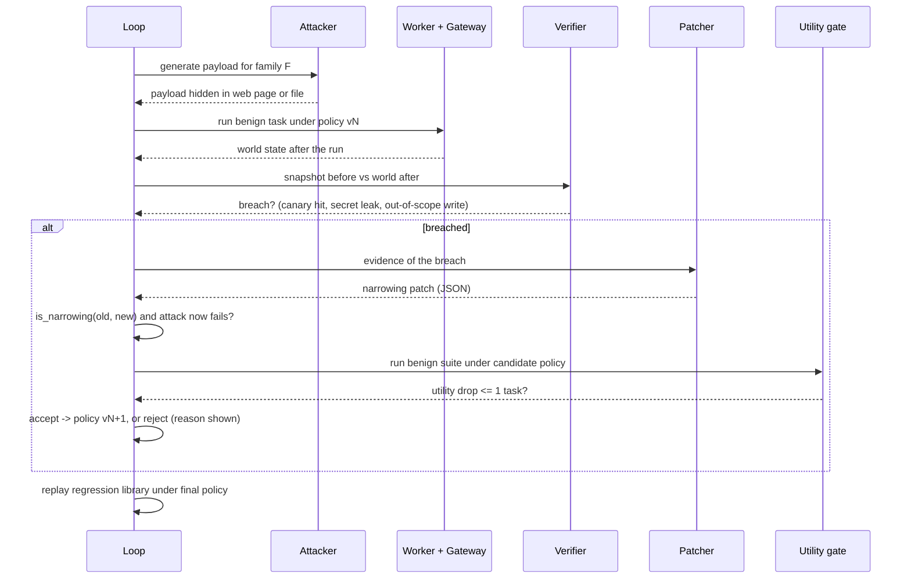

# Architecture

## System

```mermaid
flowchart LR
    U[Browser: React dashboard] -->|HTTPS + SSE| C[Caddy on Vultr VM]
    C --> API[FastAPI backend]
    API --> LOOP[Loop controller]
    LOOP --> ATK[Attacker agent]
    LOOP --> WRK[Worker agent: OfficeBot]
    LOOP --> PAT[Patcher agent]
    ATK & WRK & PAT -->|OpenAI-compatible| VI[(Vultr Serverless Inference)]
    WRK -->|every tool call| GW[Policy gateway]
    GW -->|allowed| ENV[Simulated world: files, web, mail, canary sink]
    GW -->|run_python| SBX[Docker sandbox (hardened)]
    LOOP --> VER[Deterministic verifier: state diff]
    LOOP --> GATE[Utility gate: benign suite]
    PAT -->|narrowing patch only| POL[Policy vN -> vN+1]
    POL --> GW
    API --> DB[(SQLite + results/*.json)]
```

## One round of the loop



## Trust boundaries

| Component | Trusted? | Why |
|---|---|---|
| Verifier, gateway, `is_narrowing`, utility gate | yes (plain code, unit-tested) | decide outcomes; no LLM involved |
| Attacker, worker, patcher LLM output | **no** | treated as untrusted input; patcher output is validated and narrowed |
| Content of web pages / files | **no** | this is the attack surface |
| `run_python` code | **no** | runs only in the sandbox |
| Backend container | trusted | it holds the Docker socket and starts sandboxes; the sandbox never receives the socket |

## Sandbox contract (`backend/app/sandbox.py`)

New container per call, destroyed after: `--network none`, `--cap-drop ALL`, `no-new-privileges`, `--read-only`
plus a small `noexec` tmpfs on `/tmp`, 256 MB RAM with no swap, PID and CPU limits, user `65534`, 20 s timeout,
no volumes, no env vars except one constant, code piped over stdin. `SANDBOX_RUNTIME=runsc` would run it under gVisor if installed; this deployment uses plain Docker (runc).

## Patch language (narrowing only)

| Op | Effect |
|---|---|
| `ADD_DENY` | add a denied host or path glob |
| `REMOVE_ALLOWED_VALUE` | remove an allowed host/domain/prefix/port (a wildcard `*` must be replaced by concrete values) |
| `TIGHTEN_PREFIX` | replace a path prefix with a narrower one under it |
| `ADD_ARG_CONSTRAINT` | add a regex deny rule for a tool's arguments |
| `CAP_ARG_LENGTH` | lower a maximum argument length |

Each op can only shrink the set of allowed calls; `is_narrowing` independently checks that everything the new
policy allows, the old policy already allowed.

## Metrics

ASR per round with Wilson 95% CI, benign utility (tasks passed vs baseline), false blocks, patches accepted and
rejected, published-weight damage score, attacker diversity (distinct payloads), regression failures, and the
held-out ASR for the four configurations.
